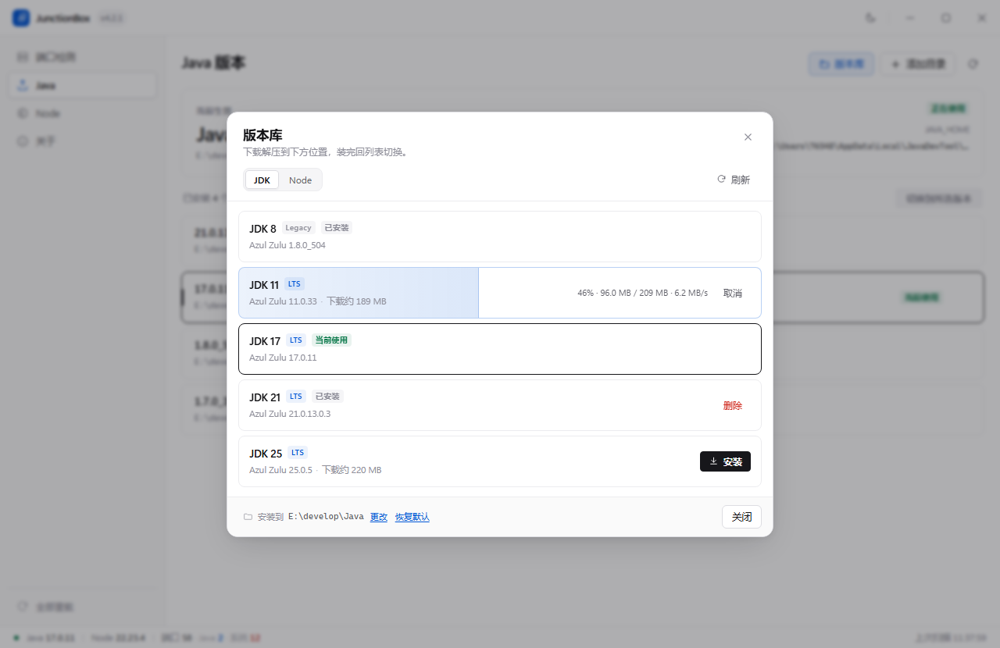
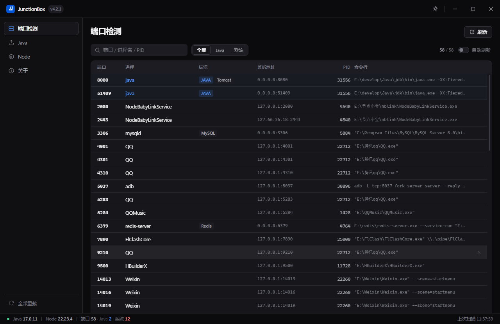

<div align="center">

# JunctionBox

**Switch JDK and Node.js versions in 15 milliseconds.**

Port inspection and runtime management for Windows.
Switching re-points an NTFS directory junction — no registry writes,
no administrator rights, no environment rebuild.

[](https://github.com/LargeAkon/JunctionBox/releases/latest)
[](https://www.electronjs.org/)
[](https://vuejs.org/)
[](./LICENSE)
[](https://github.com/LargeAkon/JunctionBox/actions/workflows/release.yml)

[Download](https://github.com/LargeAkon/JunctionBox/releases/latest) ·
[中文说明](./README.zh-CN.md) ·
[Architecture](./docs/ARCHITECTURE.md) ·
[Changelog](./CHANGELOG.md)

</div>

<table>
  <tr>
    <td width="50%"></td>
    <td width="50%"></td>
  </tr>
  <tr>
    <td align="center"><sub><b>JDK</b> — versions with vendor, one double-click to switch</sub></td>
    <td align="center"><sub><b>Node</b> — version, architecture, bundled npm</sub></td>
  </tr>
  <tr>
    <td width="50%"></td>
    <td width="50%"></td>
  </tr>
  <tr>
    <td align="center"><sub><b>Store</b> — nine runtimes, downloaded on demand</sub></td>
    <td align="center"><sub><b>Install</b> — one click, the row itself fills up</sub></td>
  </tr>
  <tr>
    <td width="50%"></td>
    <td width="50%"></td>
  </tr>
  <tr>
    <td align="center"><sub><b>Environment</b> — resolved <code>JAVA_HOME</code> and active runtimes</sub></td>
    <td align="center"><sub><b>Ports</b> — PID resolved to process and command line</sub></td>
  </tr>
  <tr>
    <td colspan="2" align="center"></td>
  </tr>
  <tr>
    <td colspan="2" align="center"><sub><b>Dark mode</b> — one toggle in the title bar, or follow the system</sub></td>
  </tr>
</table>

## Highlights

- **15 ms switching.** Re-pointing one junction beats rewriting `JAVA_HOME` and `Path`;
  measured **12–17 ms** on a warm system.
- **Environment written once.** Setup points `JAVA_HOME` and the first `Path` entry at two
  fixed junction paths. Every later switch leaves both untouched.
- **No elevation.** Junctions do not require `SeCreateSymbolicLinkPrivilege`, so the app never
  asks for UAC.
- **Port inspector.** `netstat` plus a single CIM query resolves 68 listening entries to PID,
  process name and full command line in **~600 ms**.
- **Runtime store.** JDK 8 / 11 / 17 / 21 / 25 and Node 20 / 22 / 24 / 26, streamed from mirror
  chains on demand — which is why the installer stays at **107 MB**.
- **Self-healing.** Broken junctions and stale `Path` entries are repaired at startup.
- **Native surface.** Pure-white light theme, one-click dark mode from the title bar (also
  follows the system preference), custom title bar, no browser chrome.

## How it works

Two fixed paths, created once, are what everything else depends on:

```text
JAVA_HOME          %LOCALAPPDATA%\JavaDevTool\links\jdk    ─┐
Path[0]            %LOCALAPPDATA%\JavaDevTool\links\node   ─┤  NTFS junction
                                                            │
                   E:\develop\Java\zulu-21.0.13  ◄──────────┘
```

Switching is a re-point, not an environment edit:

```text
1  verify the target contains bin\java.exe (JDK) or node.exe (Node)
2  delete the old link     [IO.Directory]::Delete(link, recursive: false)
3  create the new link     junction -> selected directory
4  update state, broadcast in the background (fire and forget)
```

Step 2 is the line that must stay non-recursive. A recursive delete on a junction follows it
into the real installation and takes the JDK with it — the same rule applies to every delete
path in the codebase.

| | Editing `JAVA_HOME` / `Path` | JunctionBox |
|---|---|---|
| Switch cost | seconds, plus a `WM_SETTINGCHANGE` broadcast | **12–17 ms** |
| Registry writes | every switch | **first-time setup only** |
| Administrator rights | usually | **never** |
| Cross-drive (C: → E:) | — | works |
| Terminals to reopen | all | all — Windows copies the environment at process start |

The last row is a platform property, not a defect: no tool can reach into a running process and
replace its environment block.

## Design decisions

| Decision | Rejected alternative | Reason |
|---|---|---|
| Directory junctions | symbolic links | Symlinks need `SeCreateSymbolicLinkPrivilege`, which means elevation for every user |
| Environment written once | rewriting on each switch | Removes the broadcast, the wait, and the stale-IDE class of bugs |
| Metadata catalog, download on demand | bundling runtimes in the installer | Nine runtimes add ~500 MB to every release and freeze the set at build time |
| System `tar.exe` (bsdtar) | `Expand-Archive`, JS unzip | 190 MB in **1 s** against 20–40 s, and no non-ASCII path bugs |
| Install ledger (`installed.json`) | path-prefix check | The install root may be the user's own JDK folder; a prefix check would point the delete button at it |
| Temp directory + atomic rename | unpacking in place | A cancelled or failed download leaves no half-installed runtime in the list |

## Tech stack

| Layer | Technology |
|---|---|
| Shell | Electron 44.9, Chromium + Node in one process tree |
| UI | Vue 3.5, no component library — every control is written against the design tokens |
| Build | Vite 8 for the renderer, electron-builder 26 for NSIS and portable targets |
| Styling | Hand-written CSS on design tokens; pure-white theme + dark mode, no UI framework |
| Process model | `contextIsolation: true`, `nodeIntegration: false`, preload bridge |
| System layer | `child_process`, PowerShell 5.1, .NET Registry API, `netstat`, CIM |
| Link layer | NTFS directory junctions (`fs.symlink` with `type: "junction"`, `[IO.Directory]`) |
| Store | Metadata catalog → mirror chain → length check → bsdtar → atomic rename |
| CI | GitHub Actions: tag push builds, packages and publishes both artifacts |

## Measured

Numbers from a single Windows 11 / i5 machine, warm cache, no antivirus exclusions.

| Operation | Result | Conditions |
|---|---|---|
| Version switch | **12–17 ms** | junction re-point, both directions |
| Port scan | ~600 ms | 68 listening entries, 2 shell invocations |
| JDK 21 extraction | ~1 s | 190 MB zip, bsdtar |
| JDK 21 download | 5.2 MB/s | Azul CDN |
| Node 22 download | 9.5 MB/s | npmmirror |
| Installer size | 107 MB | portable and NSIS builds |

## Runtime store

The catalog in [`electron/catalog.cjs`](./electron/catalog.cjs) holds metadata only —
`{ id, feature, label, ver, vendor, sizeMb, sources[] }` — and `sources` is a mirror chain tried
in order: Azul CDN → Tsinghua for JDKs, npmmirror → Tsinghua → nodejs.org for Node.

- Downloads are streamed, length-verified against `Content-Length`, and cancellable mid-flight.
- Each one unpacks into `.tmp_<id>_<timestamp>` and is only renamed into place once
  `bin\java.exe` or `node.exe` is confirmed to exist.
- A same-named directory the store did not create is never overwritten; the new one lands as a
  sibling instead.
- Deletion is restricted to the install ledger, so a user who points the store at their own
  `E:\develop\Java` never finds their own versions offered for deletion.

Full mechanics: [docs/RUNTIME-STORE.md](./docs/RUNTIME-STORE.md).

## Install

| Artifact | For |
|---|---|
| **`JunctionBox-Portable-x64.exe`** | Single file, nothing written system-wide, delete it to uninstall |
| **`JunctionBox-Setup-x64.exe`** | Start Menu entry, desktop shortcut, custom install directory |

Windows 10 / 11, x64, ~107 MB. Rolling back means installing the older package; junctions and
scan paths survive it.

```text
1  Run the executable.
2  Ports page     see who holds a port, double-click a row to end the process.
3  JDK / Node     pick a version, double-click to switch.
4  Store          nothing to switch to? install one, then pick it in the list.
5  New terminal   verify with java -version / node -v.
```

The binaries are unsigned, so SmartScreen may warn on first launch — **More info → Run anyway**,
or [build it yourself](#build-from-source).

## Build from source

Requires **Node.js 20+** on **Windows**.

```bash
git clone https://github.com/LargeAkon/JunctionBox.git
cd JunctionBox
npm install

npm run dev              # Vite + Electron with hot reload
npm run dist             # NSIS installer + portable exe into release/
npm run dist:dir         # unpacked build only, for quick checks
npm run catalog:update   # refresh the runtime catalog from vendor metadata
```

## Documentation

| Document | Audience | Contents |
|---|---|---|
| [docs/ARCHITECTURE.md](./docs/ARCHITECTURE.md) | Developers | Process model, IPC surface, junction internals, code map |
| [docs/RUNTIME-STORE.md](./docs/RUNTIME-STORE.md) | Users, developers | Catalog, mirrors, install location, ledger, layout |
| [docs/TROUBLESHOOTING.md](./docs/TROUBLESHOOTING.md) | Users | Symptom-first fixes: stale terminal, firewall, broken link |
| [CONTRIBUTING.md](./CONTRIBUTING.md) | Contributors | Build, style, commit and release flow |
| [CHANGELOG.md](./CHANGELOG.md) | Everyone | Per-release changes; source of the GitHub release notes |

## Limitations

- **Windows only.** Junctions, `netstat` output and the registry layout are platform specific;
  other systems need a different link model, not a flag.
- **Switching is global.** No per-project pinning (`.java-version`, `.nvmrc`) yet.
- **Chinese UI.** An English interface is on the roadmap.
- **Unsigned binaries.** Heuristic antivirus engines may flag the Electron bundle.

## License

[MIT](./LICENSE) © 2026 LargeAkon
