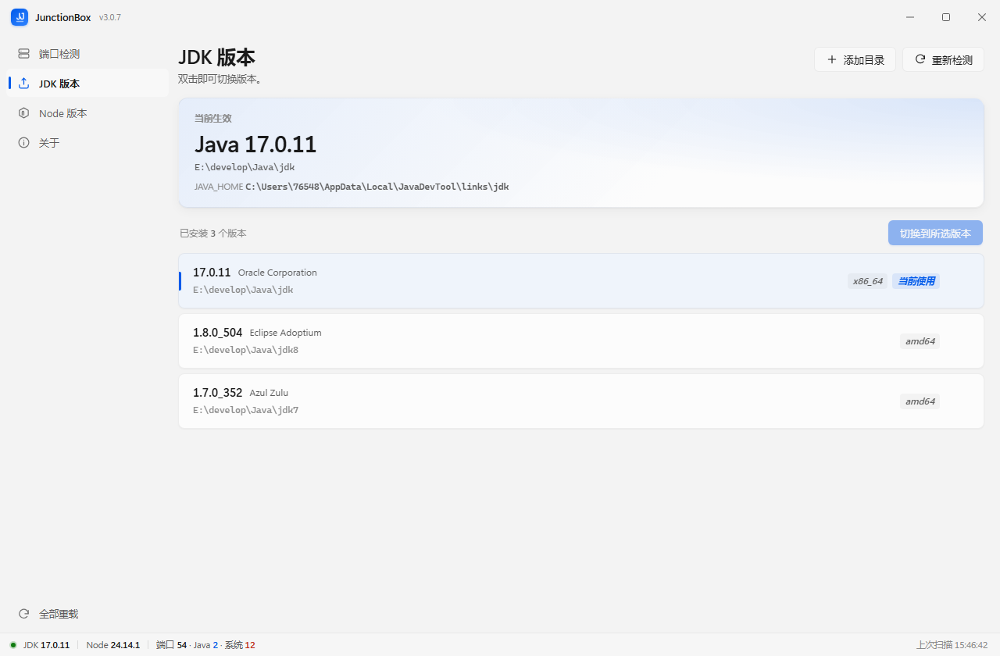
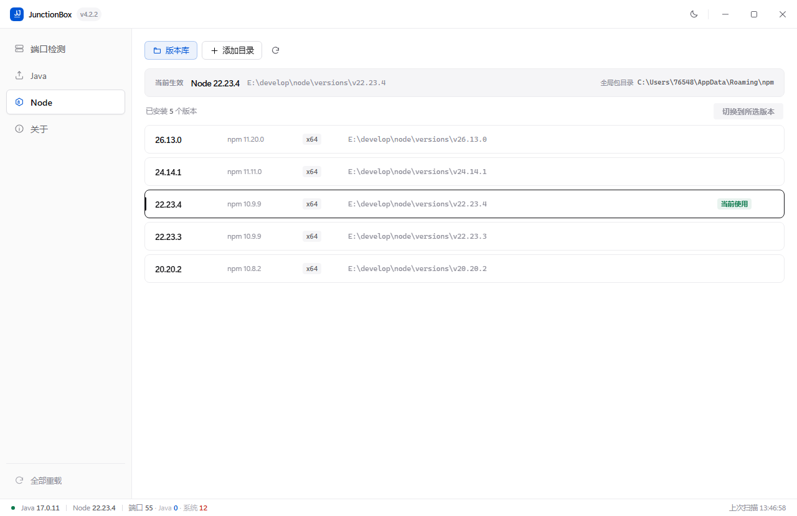
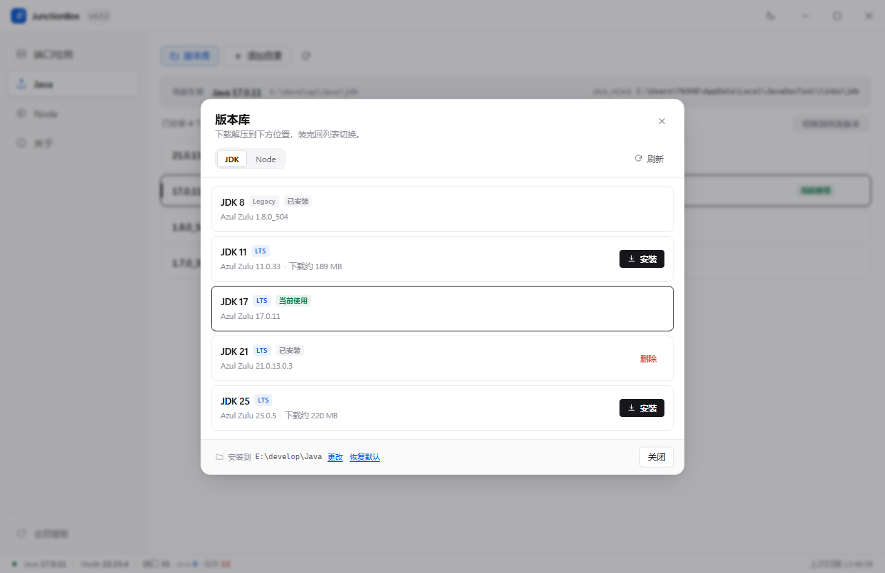
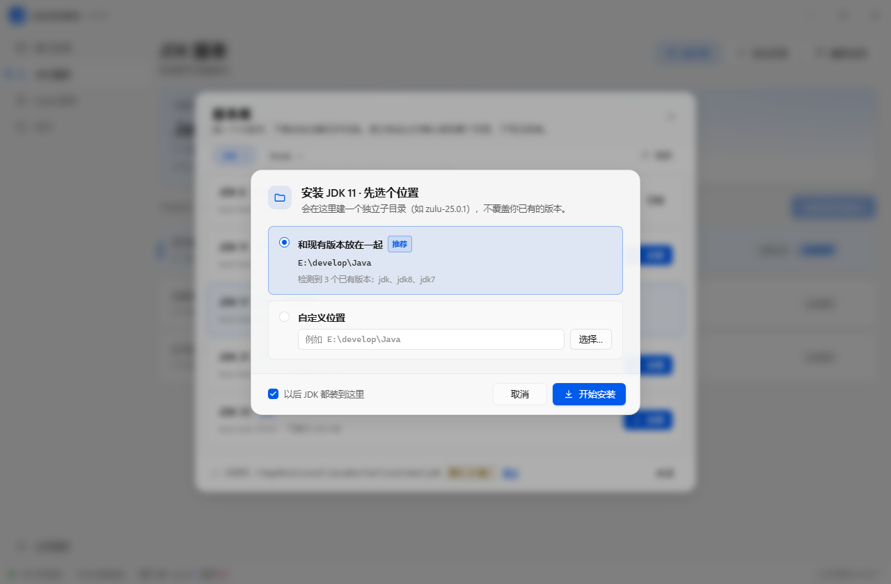
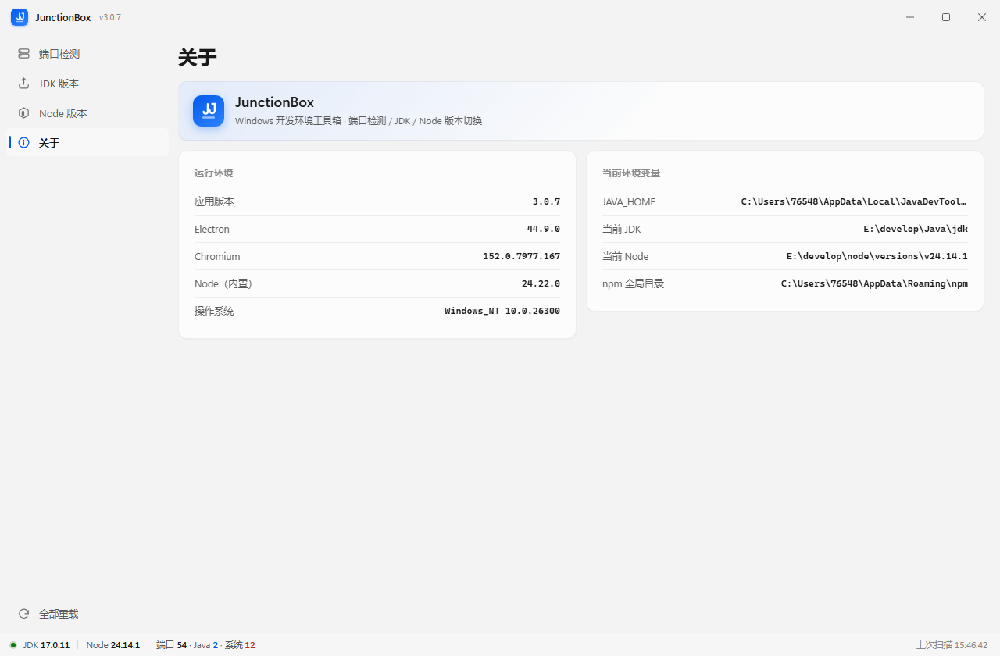
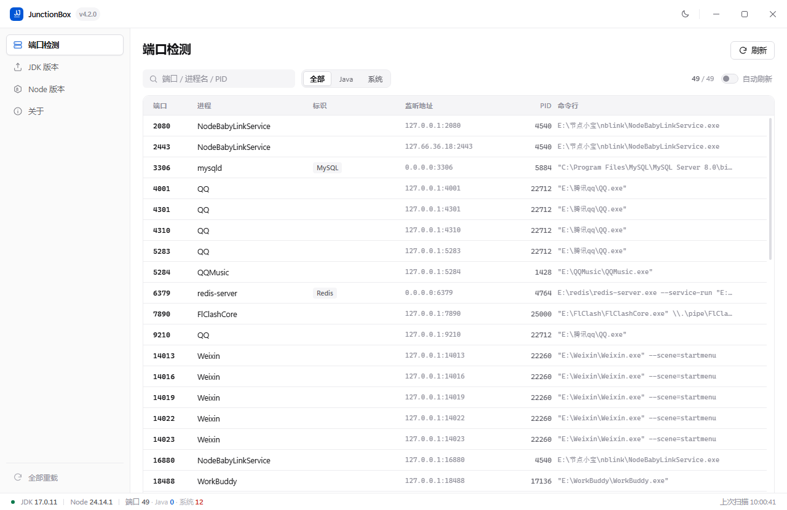

<div align="center">

# JunctionBox · 接线盒

**15 毫秒，切换 JDK 与 Node.js 版本。**

Windows 上的端口排查与运行时管理。
切换重指一个 NTFS 目录联接——不写注册表、不需要管理员权限、不重建环境。

[](https://github.com/LargeAkon/JunctionBox/releases/latest)
[](https://www.electronjs.org/)
[](https://vuejs.org/)
[](./LICENSE)
[](https://github.com/LargeAkon/JunctionBox/actions/workflows/release.yml)

[下载](https://github.com/LargeAkon/JunctionBox/releases/latest) ·
[English](./README.md) ·
[架构原理](./docs/ARCHITECTURE.md) ·
[更新日志](./CHANGELOG.md)

</div>

<table>
  <tr>
    <td width="50%"></td>
    <td width="50%"></td>
  </tr>
  <tr>
    <td align="center"><sub><b>JDK</b> — 版本与厂商，双击即切</sub></td>
    <td align="center"><sub><b>Node</b> — 版本、架构与内置 npm</sub></td>
  </tr>
  <tr>
    <td width="50%"></td>
    <td width="50%"></td>
  </tr>
  <tr>
    <td align="center"><sub><b>版本库</b> — 九个运行时，按需下载</sub></td>
    <td align="center"><sub><b>安装位置</b> — 装前问一次，默认落在你现有的目录</sub></td>
  </tr>
  <tr>
    <td width="50%"></td>
    <td width="50%"></td>
  </tr>
  <tr>
    <td align="center"><sub><b>环境概览</b> — <code>JAVA_HOME</code> 解析结果与当前运行时</sub></td>
    <td align="center"><sub><b>端口</b> — PID 解析到进程名与完整命令行</sub></td>
  </tr>
</table>

## 核心特性

- **15 毫秒切换。** 重指一个联接，取代重写 `JAVA_HOME` 与 `Path`；热态实测 **12–17 ms**。
- **环境变量只写一次。** 首次配置把 `JAVA_HOME` 与 `Path` 首项指向两个固定的联接路径，
  之后的每次切换都不再碰它们。
- **全程免提权。** 目录联接不需要 `SeCreateSymbolicLinkPrivilege`，因此从不弹 UAC。
- **端口检测。** `netstat` 加一次 CIM 查询，把 68 条监听记录解析成 PID、进程名与完整命令行，
  耗时 **约 600 ms**。
- **版本库。** JDK 8 / 11 / 17 / 21 / 25 与 Node 20 / 22 / 24 / 26，按需从镜像链流式下载——
  安装包因此保持在 **108 MB**。
- **启动自愈。** 联接失效、`Path` 残留失效项，启动时自动修复。
- **原生质感。** Mica 材质、Fluent 2 动效、自绘标题栏、`frame: false`，无浏览器边框。

## 实现原理

两个固定路径，创建一次，其余一切依赖它们：

```text
JAVA_HOME          %LOCALAPPDATA%\JavaDevTool\links\jdk    ─┐
Path[0]            %LOCALAPPDATA%\JavaDevTool\links\node   ─┤  NTFS 目录联接
                                                            │
                   E:\develop\Java\zulu-21.0.13  ◄──────────┘
```

切换是重指，不是改环境变量：

```text
1  校验目标目录含 bin\java.exe（JDK）或 node.exe（Node）
2  删除旧联接   [IO.Directory]::Delete(link, recursive: false)
3  创建新联接   junction -> 选中目录
4  更新内存状态，后台异步广播（不等待结果）
```

第 2 步是必须保持非递归的一行。对目录联接做递归删除会沿联接进入真实安装目录，
把 JDK 一起删掉——代码库里每一条删除路径都遵守这条规则。

| | 改 `JAVA_HOME` / `Path` | JunctionBox |
|---|---|---|
| 切换耗时 | 秒级，外加一次 `WM_SETTINGCHANGE` 广播 | **12–17 ms** |
| 注册表写入 | 每次切换 | **仅首次配置** |
| 管理员权限 | 通常需要 | **从不需要** |
| 跨盘（C: → E:） | — | 支持 |
| 需要重开的终端 | 全部 | 全部——Windows 在进程启动时复制环境块 |

最后一行是平台属性，不是缺陷：没有任何工具能进入正在运行的进程替换它的环境块。

## 关键取舍

| 选择 | 被否掉的方案 | 理由 |
|---|---|---|
| 目录联接 | 符号链接 | 符号链接需要 `SeCreateSymbolicLinkPrivilege`，等于要求每个用户提权 |
| 环境变量只写一次 | 每次切换重写 | 去掉广播、等待，以及一整类「IDE 里还是旧版本」的问题 |
| 元数据清单 + 按需下载 | 把运行时打进安装包 | 九个运行时让每个版本多出约 500 MB，且版本集在打包时就被冻结 |
| 系统 `tar.exe`（bsdtar） | `Expand-Archive`、JS 解压库 | 190 MB 包 **1 秒**对 20–40 秒，且没有非 ASCII 路径问题 |
| 安装台账（`installed.json`） | 路径前缀判断 | 安装根目录可能就是你自己的 JDK 目录，前缀判断会把删除按钮对准它 |
| 临时目录 + 原子改名 | 就地解压 | 取消或失败的下载不会在列表里留下半个运行时 |

## 技术栈

| 层 | 选型 |
|---|---|
| 外壳 | Electron 44.9，Chromium 与 Node 同进程树 |
| 界面 | Vue 3.5，不引入组件库，每个控件按设计令牌手写 |
| 构建 | 渲染层 Vite 8，打包 electron-builder 26（NSIS + 便携版） |
| 样式 | 手写 CSS + Fluent 2 令牌，Mica 通过 `backgroundMaterial` |
| 进程模型 | `contextIsolation: true`、`nodeIntegration: false`、preload 桥 |
| 系统层 | `child_process`、PowerShell 5.1、.NET Registry API、`netstat`、CIM |
| 联接层 | NTFS 目录联接（`fs.symlink` 的 `type: "junction"`、`[IO.Directory]`） |
| 版本库 | 元数据清单 → 镜像链 → 长度校验 → bsdtar → 原子改名 |
| CI | GitHub Actions：推送标签即构建、打包、发布两个产物 |

## 实测数据

单台 Windows 11 / i5，热缓存，未加杀软白名单。

| 操作 | 结果 | 条件 |
|---|---|---|
| 版本切换 | **12–17 ms** | 重指联接，双向 |
| 端口扫描 | 约 600 ms | 68 条监听记录，2 次 shell 调用 |
| 解压 JDK 21 | 约 1 s | 190 MB zip，bsdtar |
| 下载 JDK 21 | 5.2 MB/s | Azul CDN |
| 下载 Node 22 | 9.5 MB/s | npmmirror |
| 安装包体积 | 108 MB | 便携版与 NSIS 版 |

## 版本库

清单在 [`electron/catalog.cjs`](./electron/catalog.cjs)，只存元数据——
`{ id, feature, label, ver, vendor, sizeMb, sources[] }`，`sources` 是按下标顺序尝试的镜像链：
JDK 走 Azul CDN → 清华镜像，Node 走 npmmirror → 清华 → nodejs.org。

- 下载全程流式，用 `Content-Length` 校验长度，可在中途取消。
- 解压进 `.tmp_<id>_<时间戳>`，确认 `bin\java.exe` 或 `node.exe` 存在后才改名到正式位置。
- 同名目录若不是本程序创建的，绝不覆盖，新版本以兄弟目录落位。
- 删除只认安装台账，因此把安装位置指到自己的 `E:\develop\Java` 时，
  那里的版本永远不会出现删除按钮。

完整机制：[docs/RUNTIME-STORE.md](./docs/RUNTIME-STORE.md)。

## 安装

| 产物 | 适合 |
|---|---|
| **`JunctionBox-Portable-x64.exe`** | 单文件，不写系统目录，删掉文件即卸载 |
| **`JunctionBox-Setup-x64.exe`** | 开始菜单项、桌面快捷方式、自选安装目录 |

Windows 10 / 11，x64，约 108 MB。回退旧版本只需装回旧安装包，联接与扫描路径不受影响。

```text
1  运行程序。
2  端口页     看谁占着端口，双击行结束进程。
3  JDK/Node   选中版本，双击切换。
4  版本库     没得切？装一个，装完自动切过去。
5  新终端     用 java -version / node -v 验证。
```

程序未做代码签名，首次运行可能出现 SmartScreen 提示——点 **更多信息 → 仍要运行**，
或者[从源码构建](#从源码构建)。

## 从源码构建

需要 **Node.js 20+** 与 **Windows**。

```bash
git clone https://github.com/LargeAkon/JunctionBox.git
cd JunctionBox
npm install

npm run dev              # Vite + Electron，热更新
npm run dist             # 生成 NSIS 安装包与便携版到 release/
npm run dist:dir         # 只出未打包目录，便于快速验证
npm run catalog:update   # 从厂商元数据刷新运行时清单
```

## 文档

| 文档 | 面向 | 内容 |
|---|---|---|
| [docs/ARCHITECTURE.md](./docs/ARCHITECTURE.md) | 开发者 | 进程模型、IPC 接口、联接细节、代码地图 |
| [docs/RUNTIME-STORE.md](./docs/RUNTIME-STORE.md) | 用户 + 开发者 | 清单、镜像、安装位置、台账、目录结构 |
| [docs/TROUBLESHOOTING.md](./docs/TROUBLESHOOTING.md) | 用户 | 按现象排查：终端旧版本、防火墙、联接损坏 |
| [CONTRIBUTING.md](./CONTRIBUTING.md) | 贡献者 | 构建、风格、提交与发布流程 |
| [CHANGELOG.md](./CHANGELOG.md) | 所有人 | 每个版本的变化，也是 Release 说明的来源 |

## 已知限制

- **仅支持 Windows。** 联接、`netstat` 输出、注册表布局都是平台专有；其它系统需要另一套链接模型，
  而不是加一个开关。
- **切换是全局的。** 尚无按项目固定版本（`.java-version`、`.nvmrc`）。
- **界面仅中文。** 英文界面在路线图上。
- **未做代码签名。** 启发式杀软引擎可能对 Electron 包报警。

## 许可证

[MIT](./LICENSE) © 2026 LargeAkon
